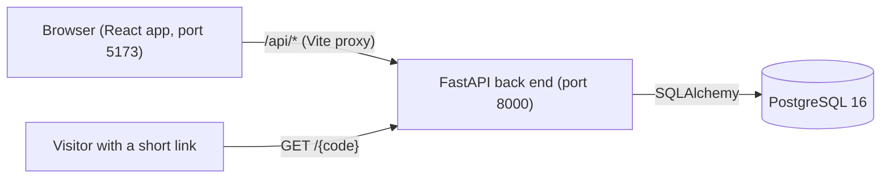

# URL Shortener

A small full-stack app: paste a long URL, get a short link. Visiting the short link redirects to the original page and counts the click. A dashboard lists all links with their clicks.

## Features
- Create a short link from any http/https URL.
- Visiting `/{code}` redirects (HTTP 307) to the original URL.
- Optional custom alias (e.g. `/my-offer`) and optional expiry date-time.
- Click counter on every link (updated atomically in the database).
- Expired links return `410 Gone`, do not redirect and do not count clicks.
- Dashboard with Copy button, clicks, status and created time. It refreshes every 10 seconds.

## Architecture



## Tech stack
- Back end: Python, FastAPI, SQLAlchemy 2, psycopg 3, pydantic-settings
- Database: PostgreSQL 16
- Front end: React + Vite (plain JavaScript)
- Tests: pytest + FastAPI TestClient (77 automated tests)

## Quality
- **77 automated tests, all passing.** They cover shortening, redirects and click counting, duplicate aliases, expired links, invalid and unsafe URLs, alias rules, expiry rules, and the own-domain/loopback block.
- Tests run against a separate `urlshortener_test` database, so real data is never touched.
- Built with a four-agent Claude Code workflow (builder, tester, verifier, pusher). The reviewer's findings are in `docs/verification-report.md`.

## How to run (Windows PowerShell, from the project root)

### 1. Settings
Copy `.env.example` to `.env` and put in your own database password. Never commit `.env`.

### 2. Database
Install PostgreSQL 16 locally (or run `docker compose up -d` if you use Docker). Create the databases `urlshortener` (app) and `urlshortener_test` (tests only), and a user that matches `DATABASE_URL` in `.env`.

Local PostgreSQL only: in `postgresql.conf` set `listen_addresses = 'localhost'` and restart the PostgreSQL service, so the database is not exposed on your network.

SQL to create the role and the two databases (run in `psql` as the `postgres` user; replace the placeholder password with your own, the same one as in `.env`):
```sql
CREATE ROLE shortener WITH LOGIN PASSWORD 'your_password_here';
CREATE DATABASE urlshortener OWNER shortener;
CREATE DATABASE urlshortener_test OWNER shortener;
```

### 3. Back end
```
python -m venv .venv
.venv\Scripts\python -m pip install -r backend\requirements.txt
.venv\Scripts\python -m uvicorn app.main:app --app-dir backend --reload
```
The API runs on http://localhost:8000 (interactive docs at `/docs`). Tables are created automatically when the server starts.

### 4. Front end
```
cd frontend
npm install
npm run dev
```
The app runs on http://localhost:5173.

### 5. Tests
```
.venv\Scripts\python -m pytest
```
Expected result: `77 passed`. Tests use the separate `urlshortener_test` database.

## API
| Method and path | What it does |
|---|---|
| `POST /api/links` | Create a link. Body: `{url, alias?, expires_at?}`. Returns 201, or 422 (invalid input) / 409 (alias taken). |
| `GET /{code}` | Redirect and add 1 click. 404 if unknown, 410 if expired. |
| `GET /api/links` | All links, newest first, with `clicks` and `status`. |
| `GET /api/health` | Returns `{"status":"ok"}`. |

Rules: alias is 3 to 32 characters (`A-Za-z0-9_-`), case-sensitive, unique, and some names are reserved (`api`, `docs`, ...). Expiry must be in the future. URLs must be http or https, have a host, and be at most 2048 characters.

## Security notes
- No passwords or keys in code. Settings come from `.env`, which is in `.gitignore`.
- All database access goes through SQLAlchemy (parameterised queries).
- CORS allows only `FRONTEND_ORIGIN`.
- Only `http` and `https` URLs are accepted (`javascript:`, `data:`, `file:` are rejected).
- URLs that point to this service itself are rejected (no redirect loops).
- Keep the database port bound to `127.0.0.1` only.

## Known limitations
- No login: the dashboard shows every link to everyone.
- No rate limiting.
- No Alembic migrations: tables are created with `create_all`, so schema changes need manual handling.
- Short codes are random, but not checked against a list of unsafe destination sites.

## Future improvements
- User accounts, so each person sees only their own links.
- Rate limiting.
- Delete / edit links, QR codes.
- Click details (time, referrer) and charts.
- Database migrations with Alembic.

<!-- Screenshots: to be added later. Put dashboard.png, form-error.png and api-docs.png in docs/screenshots/, then uncomment.

## Screenshots
Screenshots are pending: none have been added yet. Expected files in `docs/screenshots/`:

- `dashboard.png`: the dashboard with links and clicks
- `form-error.png`: the create form showing an error message
- `api-docs.png`: the API docs page (`/docs`)
-->
